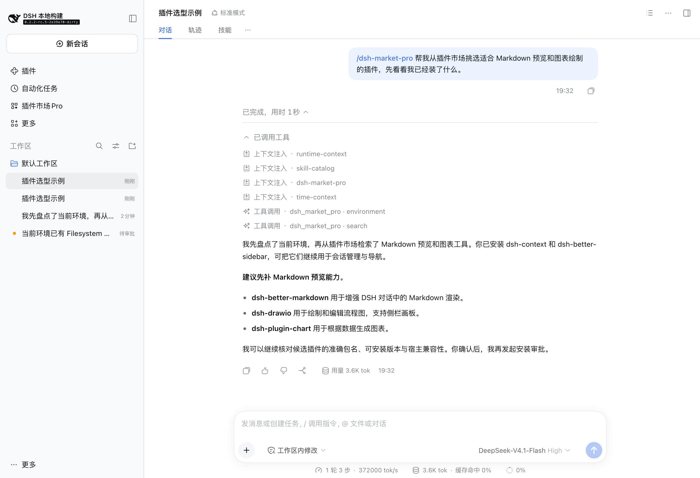
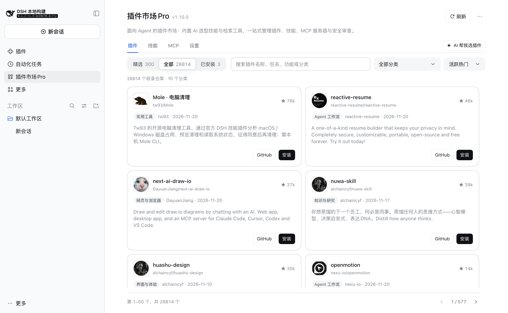
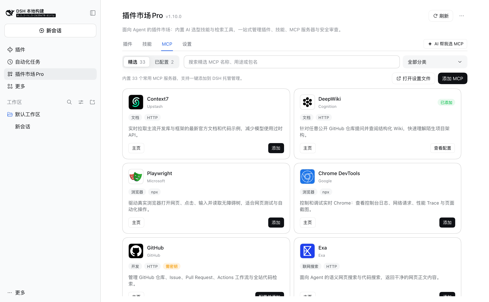
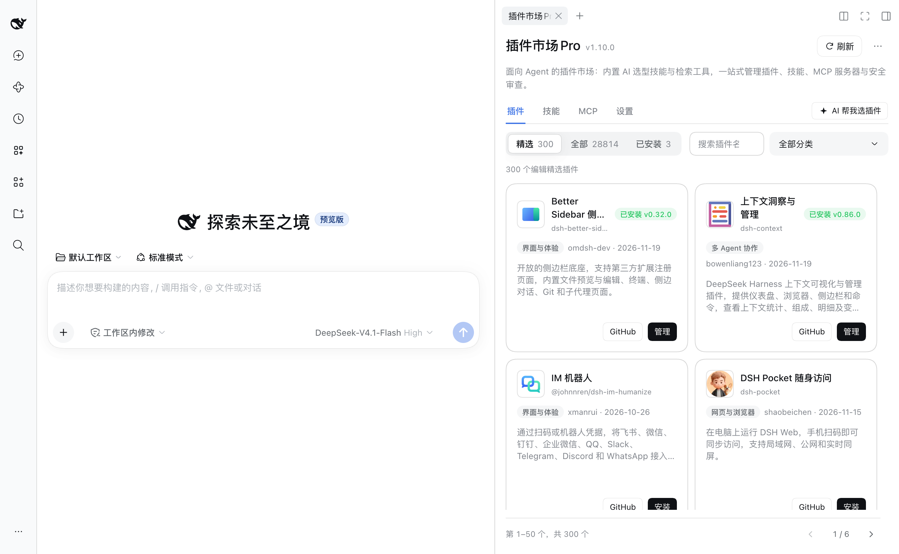

# DSH Market Pro


**面向 Agent 的 DSH 插件与 MCP 市场：内置 AI 选型技能与工具、33 个精选 MCP 目录，一站式管理插件、技能、MCP 服务器与安装后安全审查。**

中文 | [English](./README_EN.md)

DeepSeek Harness（DSH）的 AI 原生第三方插件市场。基于经过核实的社区目录 [awesome-dsh-plugin-pro](https://github.com/bruc3van/awesome-dsh-plugin-pro) 与内置精选 MCP 目录，不仅让你在一个界面里完成插件浏览与安装、版本更新、技能查看、精选 MCP 一键添加、MCP 服务器托管配置和安装后 AI 审查，更直接赋予 **DSH Agent 对话内查市场、选插件、配 MCP、给方案与安全安装** 的原生能力——告别人工翻找。


## 主要功能

- **面向 Agent 的 AI 原生选型与批量更新（双内置 Skill + 插件 & MCP 工具）**：
  - 安装并启用 `dsh-market-pro` 后，默认自动向当前 DSH 会话注册两个内置技能（**`dsh-market-pro`** 选插件与一键批量更新、**`dsh-mcp-pro`** 选并安全安装 MCP）以及对应工具 **`dsh_market_pro`** 与 **`dsh_mcp_pro`**，无需手工配置，卸载或停用插件时自动清理。
  - **直接对话即可挑插件、配 MCP、一键更插件**：在任意会话中自然语言描述需求，或输入 **`/dsh-market-pro`** / **`/dsh-mcp-pro`** 显式唤起；也可以在市场顶部点击 **「AI 帮我选插件」**（插件页）或 **「AI 帮我选 MCP」**（MCP 页）一键发起对话。
  - **精准检索与智能盘点**：支持中文分词回退、中英多同义词并查、已装/已配项过滤与批量详情核对，直接读取本地缓存的编辑精选、2.8 万+ 全量插件目录与内置 33 个精选 MCP 目录，并联合盘点当前环境已安装的插件与 MCP 避免重复推荐。
  - **纵深防注入、原生审批与零明文密钥**：所有检索与更新探测严格只读，对第三方元数据执行隐形 Unicode 剥离、尖括号中和与 `<untrusted_market_data>` / `<untrusted_mcp_data>` 协议边界隔离；插件安装经你确认后交由官方 `plugin_manager` 走宿主审批，插件批量更新（`update_plugins`）严格绑定你确认过的精确包名与版本、强制走 DSH 原生审批（fail-closed）并完整列出每一项，MCP 安装与启停（`install_featured` / `install_custom` / `set_enabled`）同样强制走原生审批并拒绝一切明文密钥、自动绑定 `${credential:REF}` 凭据模板。
  - **随时可控，兼顾零 Token 偏好**：在市场顶部的 **设置** 页签中可随时一键关闭或开启 **AI 选型助手（插件 & MCP）**，关闭后立即撤回全部内置技能与工具、回归零常驻 Token；同时也支持一键开关社区目录联网加载，修改即时生效并随当前 profile 持久化。
- **精选与全量目录**：剔除蹭标签与非插件项目。打开即展示编辑精选，同时提供完整插件目录，支持按分类筛选、关键词与包名搜索、「全部」目录按**活跃热门 / Star 最多 / 最近更新**排序，以及在精选或已安装范围搜不到时的**跨范围一键引导**。
- **一键安装**：已收录安装信息的插件可直接点击安装并启用；未提供直接安装信息的仓库，可一键生成提示词交由 AI 核实后完成安装。
- **已安装管理、筛选与一键批量更新**：集中查看已安装的插件，支持随时启用/停用（立即生效，无需重启）、卸载、按**全部状态 / 有新版**筛选，以及单插件多版本选择升级与**一键批量更新**（先弹窗确认清单、可勾选、依次更新、失败项自动跳过并支持重试、本插件自动最后更新）；当 `dsh-market-pro` 自身有新版时，主面板右上角刷新按钮旁直接提供快捷更新按钮。
- **安装后 AI 审查**：支持对已安装插件生成审查草稿并填入对话框（由你确认发送），让 AI 协助排查本地插件代码中的联网请求、凭据读取或脚本执行等潜在风险。
- **技能浏览**：通过搜索框与来源下拉选择器按项目、用户、随包提供等来源筛选当前对话可用的技能（包含本插件随附的 `dsh-market-pro` 与 `dsh-mcp-pro` 两个内置技能），直观查看每个技能的说明与调用方式。
- **MCP 精选目录与托管管理**：基于 DSH 官方 MCP 管理器（DSH ≥ 0.2.2-rc.2），分为 **精选** 与 **已配置** 两个子页签，一站式发现与管理全部 MCP 服务器：
  - **内置 33 个精选 MCP 目录**：覆盖文档、联网搜索、浏览器、开发、办公协作、图表与创作、出行与生活、记忆与思考 8 大分类（含 Context7、DeepWiki、Playwright、Chrome DevTools、GitHub、Exa、Filesystem、Fetch、高德/百度地图、12306、飞书、钉钉、语雀、Notion、AntV 图表、Next AI Draw.io、MiniMax、Figma 等）；支持分类筛选、关键词/包名搜索、自动识别已配置状态，以及一键添加或弹窗配置（密钥自动存入凭据库，并可随时切入高级编辑）；
  - **实时状态与工具弹窗**：在「已配置」视图按状态筛选、实时查看连接状态，并在独立**工具弹窗**中浏览与搜索每台服务器暴露的全部工具；
  - **完整生命周期与凭据安全**：支持添加、编辑、启停、测试连接、重启，配置**断线自动重连策略**与**关闭超时**；展示凭据来源（凭据库 / 环境变量），支持明文密钥一键转存为凭据、更新或**清除凭据**，并可一键**打开设置文件**；
  - **静态 MCP 一键转托管**：直接写入 profile 的静态 `dsh-mcp-client` 服务器不仅列出风险提示与启停开关，还支持一键**转为托管**（Host 侧自动将明文密钥安全迁入凭据库并停用原静态行）。

## 方案对比

与其他常见插件发现与管理方式相比，DSH Market Pro 将**严选数据源、精选 MCP 目录、全栈管理界面**与**可随时开关的 Agent 原生选型能力**整合在一个插件中：

| 对比维度 | DSH Market Pro（本插件） | DSH 官方发现页 (`dsh-plugin-market`) | 常见纯 UI / 泛收录社区市场 | 独立发现型 Skill / MCP 服务 |
|---|---|---|---|---|
| **数据源与筛选质量** | **严选真插件 + 精选 MCP**：每日核验并剔除蹭标签、空仓与非插件项目；提供**编辑精选 + 2.8 万+ 全量插件目录 + 33 个精选 MCP**，内置国内镜像容灾与本地持久化缓存 | 仅读取用户手动添加的 format-1 订阅索引，自身不内置社区目录 | 部分目录按 GitHub topic 泛抓取，容易混入非插件或无法安装的仓库，需人工甄别 | 依赖第三方聚合 API 或外部 CLI，对 DSH 插件结构与安装目标覆盖有限 |
| **对话内 AI 选型与配置** | **安装即默认开启，标准模式可用**：内置 `dsh-market-pro` + `dsh-mcp-pro` 双技能与 `dsh_market_pro` + `dsh_mcp_pro` 工具，支持选插件、原生审批一键批量更新插件，以及安全安装/启停 MCP | 提供 `plugin_market` 工具，但**默认仅在 Creator 模式启用**，无配套选型技能与 MCP 安装能力 | 多数侧重界面点击浏览，不提供对话内 Agent 自主查库选型 | 可在对话中检索，但需额外配置独立 MCP 子进程或外部 CLI，缺少可视化管理界面 |
| **环境感知与去重** | 自动联合盘点当前 profile **已安装插件 + 托管/静态 MCP 与工具组**，自动过滤已装项并推荐互补能力 | 标注订阅条目的安装状态，不含 MCP/技能联合盘点 | 多以卡片已安装徽章为主，不参与对话级能力规划 | 通常无法直接读取当前 DSH profile 的已安装插件与托管 MCP 状态 |
| **一站式管理范围** | **插件 + 技能 + 精选与托管 MCP + 市场设置**四合一（支持热启停、有新版筛选与一键批量更新、精选 MCP 一键添加、转托管、凭据管理与工具弹窗） | 聚焦插件发现与管理，不含技能页和 MCP 托管界面 | 侧重插件浏览、评分或社区讨论，通常需另装插件管理 MCP 与技能 | 仅聚焦单一类型（只搜 Skill 或只搜 MCP），不含宿主插件管理 |
| **安全与防注入** | **纵深防注入**（剥离隐形 Unicode + 尖括号中和 + 数据边界隔离）+ 官方 `plugin_manager` / 原生审批 + **零明文密钥凭据模板** + **安装后只读 AI 审查** | 工具描述声明不可信数据，安装走官方 `plugin_manager` 审批 | 各方案策略不一，以页面提示或安装时校验为主 | 多依赖提示词提醒先确认，较少提供协议级数据隔离与零明文密钥强校验 |
| **Token 开销控制** | 紧凑单语输出 + 批量查询省轮次；可在 **设置页一键关闭**，立即撤回全部技能与工具，回归**零常驻 Token** | 仅在启用该工具的预设中占用工具声明 | 被动 UI 运行，无常驻对话开销 | 外部 MCP 常驻子进程并持续注入工具 schema |

> 以上对比基于各方案公开形态与典型定位，不同工具各有侧重（例如纯 UI 市场适合偏好社区评论与截图浏览的用户）。如果你希望在 DSH 中同时获得**经过核实的真插件数据源、内置精选 MCP 目录、插件/技能/MCP 一体化管理**以及**开箱即用、随时可关的 Agent 原生选型闭环**，DSH Market Pro 会更省心。

## 安装方式

1. 打开 DSH 左侧导航栏的 **插件** 页面。
2. 在官方插件安装界面中输入 **`dsh-market-pro`** 进行安装并启用。
3. 安装完成后，即可从左侧导航栏的 **插件市场Pro**、插件页顶部标签或会话右侧边栏打开市场，也可以直接在对话中向 DSH 提问或使用 **`/dsh-market-pro`** / **`/dsh-mcp-pro`** 让 Agent 帮你选插件、配 MCP。

## 对话内 AI 选型与安装示例

截图中的对话由本地演示模型驱动。DSH 实际执行工具并生成审批卡片。

### 1. 选插件（`/dsh-market-pro`）

安装后默认开启，在 DSH 对话框中直接输入：

```text
我想让 DSH 帮我做文档导出和图表绘制，先看看我目前装了哪些插件，再从市场里推荐几个活跃的方案
```

或者使用斜杠命令显式调用内置技能：

```text
/dsh-market-pro 帮我找适合前端研发和接口联调的插件与 MCP 组合
```

Agent 会通过 `dsh_market_pro` 自动完成以下流程：

1. **环境盘点**（`environment`）：了解当前 profile 已安装的插件和 MCP，避免重复推荐。
2. **精选与全量检索**（`featured` / `search` / `detail`）：优先检索编辑精选与可直装插件，按需扩展至数万社区仓库并核对安装目标与前置依赖。
3. **对比建议与安全安装**：给出 2–4 个候选对比；在你确认后，调用官方 `plugin_manager` 安装（保留宿主原生审批与脚本授权），并可继续执行只读安全审查。



### 2. 检查与一键批量更新插件（`/dsh-market-pro`）

在对话中直接输入：

```text
/dsh-market-pro 帮我检查已安装插件有没有新版本，确认后一键更新到最新版
```

Agent 会通过 `dsh_market_pro` 执行安全更新闭环：

1. **只读检查更新**（`check_updates`）：同时检查 npm registry 与已配置的 Git 订阅源，列出每个可更新插件的当前版本与最新兼容稳定版。
2. **锁定版本 + 原生审批更新**（`update_plugins`）：经你确认后仅提交已确认的精确 `{ packageName, version }` 列表，触发 DSH 原生审批完整列出全部更新项；执行时自动将 `dsh-market-pro` 排在最后，失败项自动跳过并保留回滚提示，最后汇总成功、需重启与失败详情。

### 3. 选配与安全安装 MCP（`/dsh-mcp-pro`）

在对话中直接输入 `/dsh-mcp-pro` 或点击 MCP 页右上角的 **「AI 帮我选 MCP」**：

```text
/dsh-mcp-pro 先盘点我当前已配置的 MCP，再推荐适合查最新框架文档和画图表的精选 MCP，确认后帮我安全安装
```

Agent 会通过 `dsh_mcp_pro` 完成端到端安全闭环：

1. **只读盘点与筛选**（`list_configured` / `search_featured` / `detail`）：自动跳过已配置的同类 MCP，对比连接方式（`HTTP` / `npx` / `uvx`）与凭据需求。
2. **宿主原生审批写入**（`install_featured` / `install_custom` / `set_enabled`）：经你在对话确认后发起 DSH 原生审批，完整展示实际命令、端点、工作目录、环境变量与请求头，拒绝即止。
3. **全程零明文密钥**：需要 API Key 的服务器自动绑定 `${credential:REF}` 凭据模板，不要求在对话中粘贴密钥；保存后直接引导你前往 **插件市场Pro → MCP → 已配置** 点击 **填写** 安全存入凭据库。


> 如需关闭或重新开启该能力，打开 **插件市场Pro → 设置**，切换 **AI 选型助手（插件 & MCP）** 即可实时生效。

## 界面预览

### 市场设置（AI 助手与数据源开关）

在 **设置** 页签中一键管理 **AI 选型助手（插件 & MCP）** 与 **社区插件目录**，即时生效并随当前 profile 持久化，也可以直接点击按钮在对话中试用 AI 选型。


### 全量目录与排序

切换到 **全部** 浏览完整收录目录，按分类筛选并自由切换 **活跃热门**、**Star 最多**、**最近更新** 排序方式。



### MCP 精选目录、托管管理与工具查看

在 **MCP** 页签中先通过 **精选** 子页签浏览内置的 33 个精选 MCP 服务器（支持按分类筛选、关键词检索、已添加识别与一键配置添加），再切至 **已配置** 集中管理托管与静态 MCP 服务器：按状态筛选、查看凭据来源与清除操作、一键打开设置文件、将静态 MCP 转为托管，并在独立弹窗中搜索查看服务器提供的全部工具。




### 侧边栏快捷入口

除了左侧主导航外，也可以在任意对话中展开右侧边栏，快速打开 **插件市场Pro**。



### 已安装管理、筛选与一键更新

在 **已安装** 页面管理当前环境中的插件，支持按 **全部状态 / 有新版** 筛选、随时启停或卸载、单插件多版本选择升级，以及点击 **一键更新** 确认清单后按顺序批量升级（失败自动跳过并支持重试失败项）；当本插件有新版本时，主面板右上角也会直接展示快捷更新按钮。


### 安装后 AI 安全审查

在安装完成弹窗或已安装插件卡片上点击 **AI 审查**，自动在会话输入框中准备审查提示词草稿，由你发送给 AI 进行只读检查。


### 技能页

在市场顶部的 **技能** 页签或对话标题下方的 **技能** 入口中，通过搜索框与来源下拉筛选当前会话可用的全部技能（包含随包提供的 `dsh-market-pro` 与 `dsh-mcp-pro` 技能），直观查看调用方式（AI 可调用或 `/名称` 调用）。


## 使用提示

- **安全提醒**：目录收录仅核实项目是否为 DSH 插件，不代表安全背书。安装前请留意插件来源与权限要求。
- **关于 AI 审查**：AI 审查是在插件安装后对本地文件进行的辅助检查，供你评估风险参考，无法阻止或撤销插件安装时已经发生的执行。

## 相关项目

- **[DSH Desktop Pro](https://github.com/bruc3van/dsh-desktop-pro)**：让 Agent 安全常驻桌面的独立 DeepSeek Harness 客户端。
- **[awesome-dsh-plugin-pro](https://github.com/bruc3van/awesome-dsh-plugin-pro)**：经过每日核实的 DSH 社区插件目录，也是本市场的数据来源。
- **[deepseek-harness](https://github.com/deepseek-ai/deepseek-harness)**：DeepSeek Harness 官方仓库。

## 许可证

[MIT](./LICENSE)
