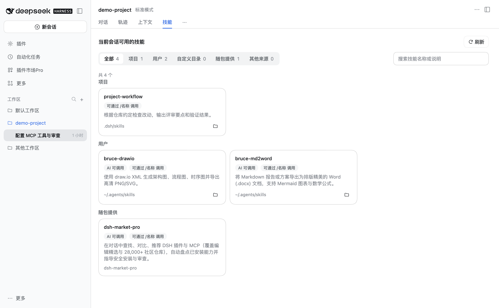

# DSH Market Pro


**面向 Agent 的 DSH 插件市场：内置 AI 选型技能与只读检索工具，一站式管理插件、技能、MCP 服务器与安装后安全审查。**

中文 | [English](./README_EN.md)

DeepSeek Harness（DSH）的 AI 原生第三方插件市场。基于经过核实的社区目录 [awesome-dsh-plugin-pro](https://github.com/bruc3van/awesome-dsh-plugin-pro)，不仅让你在一个界面里完成插件浏览与安装、版本更新、技能查看、MCP 服务器托管配置和安装后 AI 审查，更直接赋予 **DSH Agent 对话内查市场、选插件、给方案与安全安装** 的原生能力——告别人工翻找。


## 主要功能

- **面向 Agent 的 AI 原生选型（内置 Skill + 只读 Tool）**：
  - 安装并启用 `dsh-market-pro` 后，默认自动向当前 DSH 会话注册内置技能 **`dsh-market-pro`** 与只读检索工具 **`dsh_market_pro`**，无需手工配置，卸载或停用插件时自动清理。
  - **直接对话即可挑插件**：在任意会话中自然语言描述需求（如“帮我找一个好用的 Git 或飞书插件”），或输入 **`/dsh-market-pro`** 显式唤起，也可以在市场顶部直接点击 **「AI 帮我选」** 发起对话。
  - **精准检索与智能盘点**：内置中文分词回退、中英多同义词并查、已装项过滤与批量详情核对，直接读取本地缓存的编辑精选与 2.8 万+ 全量目录，并联合盘点当前环境已安装的插件与 MCP 避免重复推荐。
  - **纵深防注入与审批安装闭环**：检索工具严格只读，对第三方元数据执行隐形 Unicode 剥离、标签中和与 `<untrusted_market_data>` 协议边界隔离，防止恶意插件文本注入劫持 Skill；经你确认后，由 Agent 将可验证的安装目标交给 DSH 官方 `plugin_manager` 走宿主审批流程安装，并支持安装后只读安全审查。
  - **随时可控，兼顾零 Token 偏好**：在市场顶部的 **设置** 页签中可随时一键关闭或开启 AI 插件选型助手，关闭后立即撤回技能与工具、回归零常驻 Token；同时也支持一键开关社区目录联网加载，修改即时生效并随当前 profile 持久化。
- **精选与全量目录**：剔除蹭标签与非插件项目。打开即展示编辑精选，同时提供完整插件目录，支持按分类筛选、关键词与包名搜索、「全部」目录按**活跃热门 / Star 最多 / 最近更新**排序，以及在精选或已安装范围搜不到时的**跨范围一键引导**。
- **一键安装**：已收录安装信息的插件可直接点击安装并启用；未提供直接安装信息的仓库，可一键生成提示词交由 AI 核实后完成安装。
- **已安装管理与更新**：集中查看已安装的插件，支持随时启用/停用（立即生效，无需重启）、卸载，或一键检查新版本并完成升级。
- **安装后 AI 审查**：支持对已安装插件生成审查草稿并填入对话框（由你确认发送），让 AI 协助排查本地插件代码中的联网请求、凭据读取或脚本执行等潜在风险。
- **技能浏览**：按项目、用户、内置等来源筛选和搜索当前对话可用的技能（包含本插件随附的 `dsh-market-pro` 技能），直观查看每个技能的说明与调用方式。
- **MCP 管理**：基于 DSH 官方 MCP 管理器（DSH ≥ 0.2.2-rc.2）集中管理所有 MCP 服务器：
  - 实时查看连接状态，在独立**工具弹窗**中浏览与搜索每台服务器暴露的全部工具；
  - 支持添加、编辑、启停、测试连接、重启，并可配置**断线自动重连策略**与**关闭超时**；
  - 展示凭据来源（凭据库 / 环境变量），支持明文密钥一键转存为凭据、更新或**清除凭据**，并可一键**打开设置文件**；
  - 直接写入 profile 的静态 `dsh-mcp-client` 服务器不仅列出风险提示与启停开关，还支持一键**转为托管**（Host 侧自动将明文密钥安全迁入凭据库并停用原静态行）。

## 方案对比

与其他常见插件发现与管理方式相比，DSH Market Pro 将**严选数据源、全栈管理界面**与**可随时开关的 Agent 原生选型能力**整合在一个插件中：

| 对比维度 | DSH Market Pro（本插件） | DSH 官方发现页 (`dsh-plugin-market`) | 常见纯 UI / 泛收录社区市场 | 独立发现型 Skill / MCP 服务 |
|---|---|---|---|---|
| **数据源与筛选质量** | **严选真插件**：每日核验并剔除蹭标签、空仓与非插件项目；同时提供**编辑精选 + 2.8 万+ 全量目录**，内置国内镜像容灾与本地持久化缓存 | 仅读取用户手动添加的 format-1 订阅索引，自身不内置社区目录 | 部分目录按 GitHub topic 泛抓取，容易混入非插件或无法安装的仓库，需人工甄别 | 依赖第三方聚合 API 或外部 CLI，对 DSH 插件结构与安装目标覆盖有限 |
| **对话内 AI 选插件** | **安装即默认开启，标准模式可用**：内置 `dsh-market-pro` 技能 + 同进程只读检索工具 `dsh_market_pro`（支持中文分词、多同义词并查与批量详情） | 提供 `plugin_market` 工具，但**默认仅在 Creator 模式启用**，无配套选型技能 | 多数侧重界面点击浏览，不提供对话内 Agent 自主查库选型 | 可在对话中检索，但需额外配置独立 MCP 子进程或外部 CLI，缺少可视化管理界面 |
| **环境感知与去重** | 自动联合盘点当前 profile **已安装插件 + 已连接 MCP 工具组**，可过滤已装项并推荐互补能力 | 标注订阅条目的安装状态，不含 MCP/技能联合盘点 | 多以卡片已安装徽章为主，不参与对话级能力规划 | 通常无法直接读取当前 DSH profile 的已安装插件与托管 MCP 状态 |
| **一站式管理范围** | **插件 + 技能 + MCP 服务器 + 市场设置**四合一（支持热启停、版本更新、MCP 托管/转托管、凭据管理与工具弹窗） | 聚焦插件发现与管理，不含技能页和 MCP 托管界面 | 侧重插件浏览、评分或社区讨论，通常需另装插件管理 MCP 与技能 | 仅聚焦单一类型（只搜 Skill 或只搜 MCP），不含宿主插件管理 |
| **安全与防注入** | **纵深防注入**（剥离隐形 Unicode + 尖括号中和 + `<untrusted_market_data>` 边界隔离）+ 官方 `plugin_manager` 审批安装 + **安装后只读 AI 审查** | 工具描述声明不可信数据，安装走官方 `plugin_manager` 审批 | 各方案策略不一，以页面提示或安装时校验为主 | 多依赖提示词提醒先确认，较少提供协议级数据隔离与隐形注入净化 |
| **Token 开销控制** | 紧凑单语输出 + 批量查询省轮次；可在 **设置页一键关闭**，立即撤回技能与工具，回归**零常驻 Token** | 仅在启用该工具的预设中占用工具声明 | 被动 UI 运行，无常驻对话开销 | 外部 MCP 常驻子进程并持续注入工具 schema |

> 以上对比基于各方案公开形态与典型定位，不同工具各有侧重（例如纯 UI 市场适合偏好社区评论与截图浏览的用户）。如果你希望在 DSH 中同时获得**经过核实的真插件数据源、插件/技能/MCP 一体化管理**以及**开箱即用、随时可关的 Agent 原生选型闭环**，DSH Market Pro 会更省心。

## 安装方式

1. 打开 DSH 左侧导航栏的 **插件** 页面。
2. 在官方插件安装界面中输入 **`dsh-market-pro`** 进行安装并启用。
3. 安装完成后，即可从左侧导航栏的 **插件市场Pro**、插件页顶部标签或会话右侧边栏打开市场，也可以直接在对话中向 DSH 提问或使用 **`/dsh-market-pro`** 让 Agent 帮你挑选插件。

## 对话内 AI 选插件示例

安装后默认开启，在 DSH 对话框中直接输入：

```text
我想让 DSH 帮我做文档导出和图表绘制，先看看我目前装了哪些插件，再从市场里推荐几个活跃的方案
```

或者使用斜杠命令显式调用内置技能：

```text
/dsh-market-pro 帮我找适合前端研发和接口联调的插件与 MCP 组合
```

Agent 会通过只读工具 `dsh_market_pro` 自动完成以下流程：

1. **环境盘点**（`environment`）：了解当前 profile 已安装的插件和 MCP，避免重复推荐。
2. **精选与全量检索**（`featured` / `search` / `detail`）：优先检索编辑精选与可直装插件，按需扩展至数万社区仓库并核对安装目标与前置依赖。
3. **对比建议与安全安装**：给出 2–4 个候选对比；在你确认后，调用官方 `plugin_manager` 安装（保留宿主原生审批与脚本授权），并可继续执行只读安全审查。


> 如需关闭或重新开启该能力，打开 **插件市场Pro → 设置**，切换 **AI 插件选型助手（面向 Agent）** 即可实时生效。

## 界面预览

### 市场设置（AI 助手与数据源开关）

在 **设置** 页签中一键管理 **AI 插件选型助手（面向 Agent）** 与 **社区插件目录联网加载**，即时生效并随当前 profile 持久化，也可以直接点击按钮在对话中试用 AI 选插件。


### 全量目录与排序

切换到 **全部** 浏览完整收录目录，按分类筛选并自由切换 **活跃热门**、**Star 最多**、**最近更新** 排序方式。


### MCP 服务器管理与工具查看

在 **MCP** 页签集中管理托管与静态 MCP 服务器：查看实时状态、凭据来源与清除操作、一键打开设置文件、将直接配置的静态 MCP 转为托管，并在独立弹窗中搜索查看服务器提供的全部工具。


### 侧边栏快捷入口

除了左侧主导航外，也可以在任意对话中展开右侧边栏，快速打开 **插件市场Pro**。


### 已安装管理与检查更新

在 **已安装** 页面管理当前环境中的插件，一键切换启用状态、检查可用更新或卸载插件。


### 安装后 AI 安全审查

在安装完成弹窗或已安装插件卡片上点击 **AI 审查**，自动在会话输入框中准备审查提示词草稿，由你发送给 AI 进行只读检查。


### 技能页

在市场顶部的 **技能** 页签或对话标题下方的 **技能** 入口中，查看当前会话可用的全部技能、来源分类及调用方式（AI 自动调用或 `/名称` 手动调用）。




## 使用提示

- **安全提醒**：目录收录仅核实项目是否为 DSH 插件，不代表安全背书。安装前请留意插件来源与权限要求。
- **关于 AI 审查**：AI 审查是在插件安装后对本地文件进行的辅助检查，供你评估风险参考，无法阻止或撤销插件安装时已经发生的执行。

## 相关项目

- **[DSH Desktop Pro](https://github.com/bruc3van/dsh-desktop-pro)**：让 Agent 安全常驻桌面的独立 DeepSeek Harness 客户端。
- **[awesome-dsh-plugin-pro](https://github.com/bruc3van/awesome-dsh-plugin-pro)**：经过每日核实的 DSH 社区插件目录，也是本市场的数据来源。
- **[deepseek-harness](https://github.com/deepseek-ai/deepseek-harness)**：DeepSeek Harness 官方仓库。

## 许可证

[MIT](./LICENSE)
