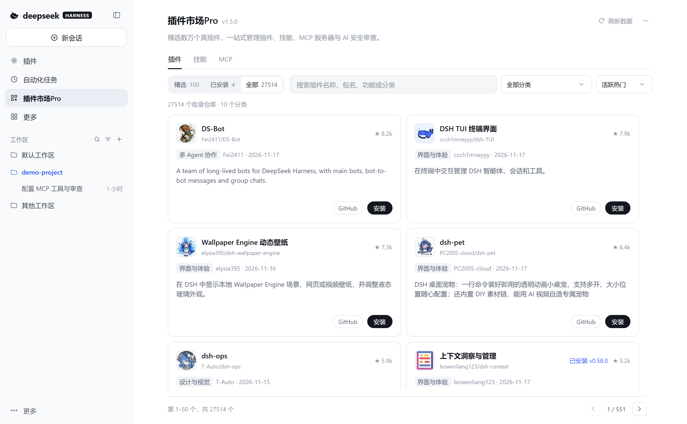
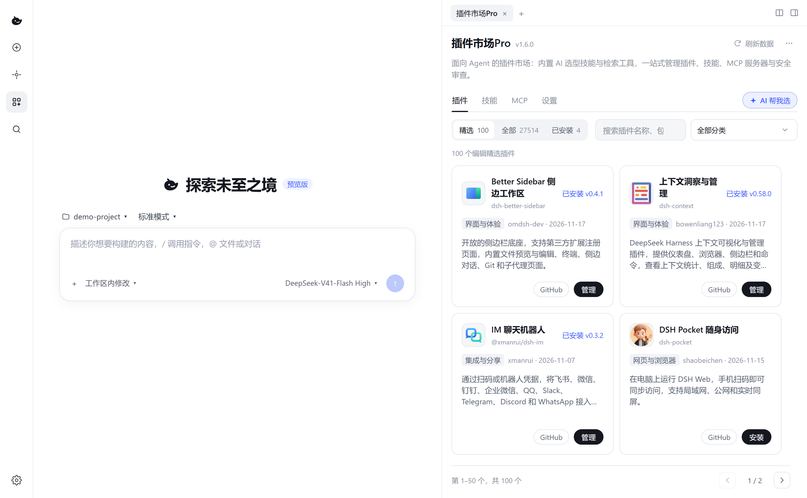
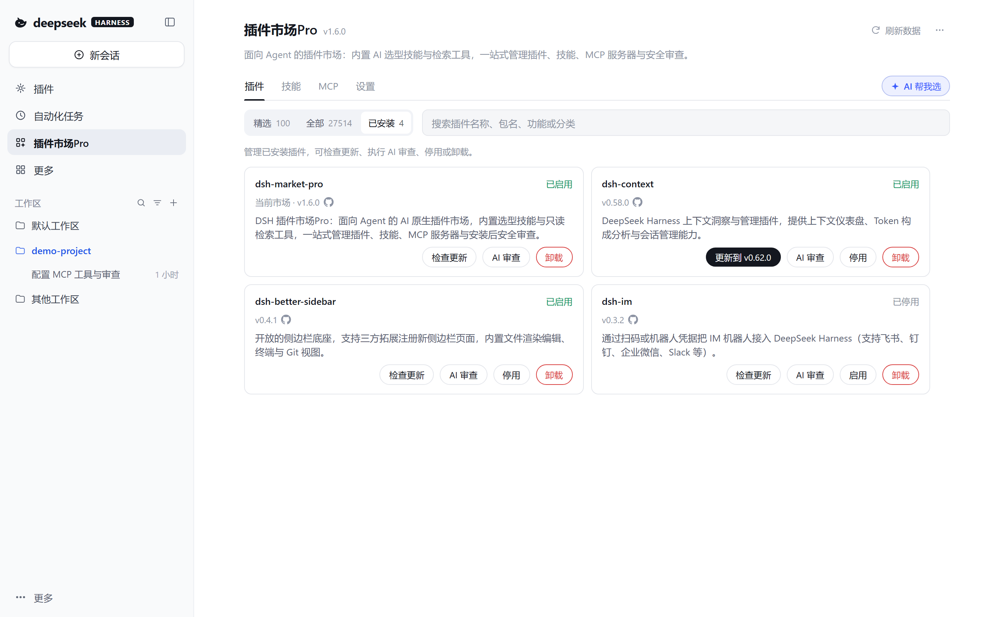
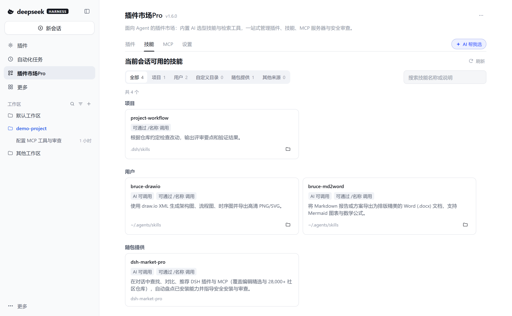
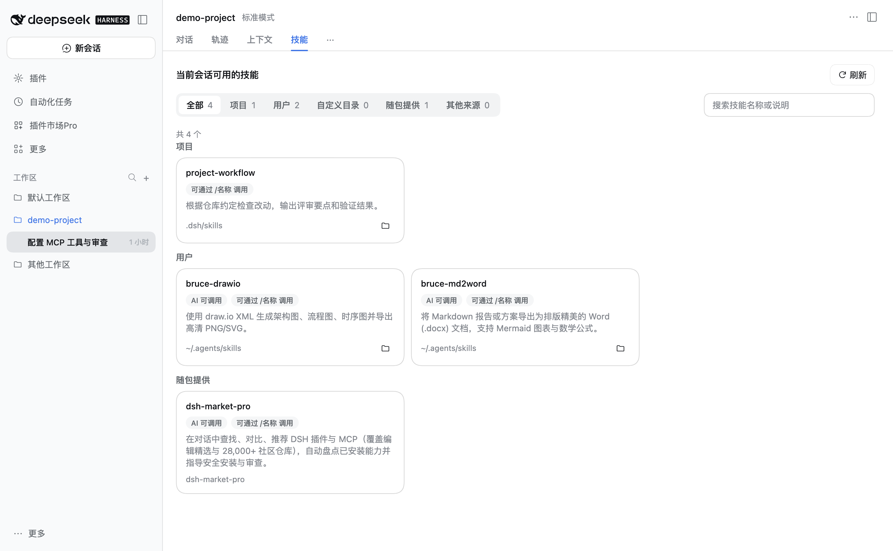

# DSH Market Pro

**Curated plugins, skills, and MCP servers: browse, install, configure, update, and review with AI.**

[中文](./README.md) | English

A third-party plugin marketplace for DeepSeek Harness (DSH), powered by the verified community catalog [awesome-dsh-plugin-pro](https://github.com/bruc3van/awesome-dsh-plugin-pro). Discover, install, update, inspect session skills, manage MCP servers, and run post-install AI security reviews in one place.

## Key Features

- **Curated & Full Catalog**: Filters out unrelated projects and topic riders. Opens on editor's picks while offering the full verified catalog with category filters, keyword/package search, **Active & popular / Most stars / Recently updated** sorting in **All**, and guided cross-scope switching when a narrower view has no matches.
- **One-Click Install**: Install and enable plugins directly from their cards; for repositories without direct install metadata, generate a prompt draft so your AI agent can verify and install them for you.
- **Manage & Update Installed Plugins**: View all installed plugins in one place, enable or disable them instantly without restarting, uninstall, or check for and install newer versions.
- **Post-Install AI Review**: Prepare a review draft in your conversation input box (sent only when you confirm) to have your AI agent inspect installed plugin files for network calls, credential access, scripts, and other potential risks.
- **Skills Browser**: Browse and search skills available in the active conversation by source (Project, User, Bundled, etc.) and see how each skill can be invoked.
- **MCP Management**: Built on DSH's official MCP manager (DSH ≥ 0.2.2-rc.2) to manage every MCP server in one view:
  - Inspect live connection states and browse or search each server's exposed tools in a dedicated **Tools dialog**;
  - Add, edit, enable/disable, probe, and restart servers, including **auto-reconnect** and **close-timeout** settings;
  - See credential sources (credential store / environment), move plaintext secrets to credentials, update or **clear** stored values, and **open the native settings file** in one click;
  - Static `dsh-mcp-client` rows written straight into the profile show risk notices, toggle controls, and one-click **Manage** adoption (moving plaintext secrets to credentials on the Host and disabling the static row safely).

## Installation

1. Open the **Plugins** page from the left navigation bar in DSH.
2. Enter **`dsh-market-pro`** in the official plugin installation interface to install and enable it.
3. Once installed, open **DSH Market Pro** anytime from the left navigation bar, the Plugins page tab, or the right sidebar inside a conversation.

## Interface Preview

### Full Catalog & Sorting

Switch to **All** to explore the full verified catalog with category filters and **Active & popular**, **Most stars**, or **Recently updated** sorting.

### MCP Server Management & Tools Dialog

Manage both managed and static MCP servers under the **MCP** tab: monitor live status, inspect and clear credentials, open the settings file, convert static rows to managed servers, and search exposed tools in a dedicated dialog.

### Right Sidebar Shortcut

In addition to the main navigation bar, you can open **DSH Market Pro** directly from the right sidebar inside any session.

### Installed Plugins & Updates

Manage your installed plugins under the **Installed** tab: toggle enable/disable states live, check for updates, or uninstall.

### Post-Install AI Review

Click **AI review** after installation or on any installed plugin card to prepare a read-only security review prompt in your conversation input box.

### Skills Page

Check the skills available to your current session from the **Skills** tab in the market or below the conversation title, complete with source filters and invocation labels.

## Usage Notes

- **Security reminder**: Catalog inclusion verifies that a project is a DSH plugin, not that it is safe. Always review a plugin's source and requested permissions before installing.
- **About AI review**: AI review is an optional post-install check on local plugin files to help you assess risk; it cannot prevent or undo code that has already executed during installation.

## Related Projects

- **[DSH Desktop Pro](https://github.com/bruc3van/dsh-desktop-pro)**: Standalone DeepSeek Harness desktop client.
- **[awesome-dsh-plugin-pro](https://github.com/bruc3van/awesome-dsh-plugin-pro)**: Verified DSH community plugin catalog and data source for this market.
- **[deepseek-harness](https://github.com/deepseek-ai/deepseek-harness)**: Official DeepSeek Harness repository.

## License

[MIT](./LICENSE)
